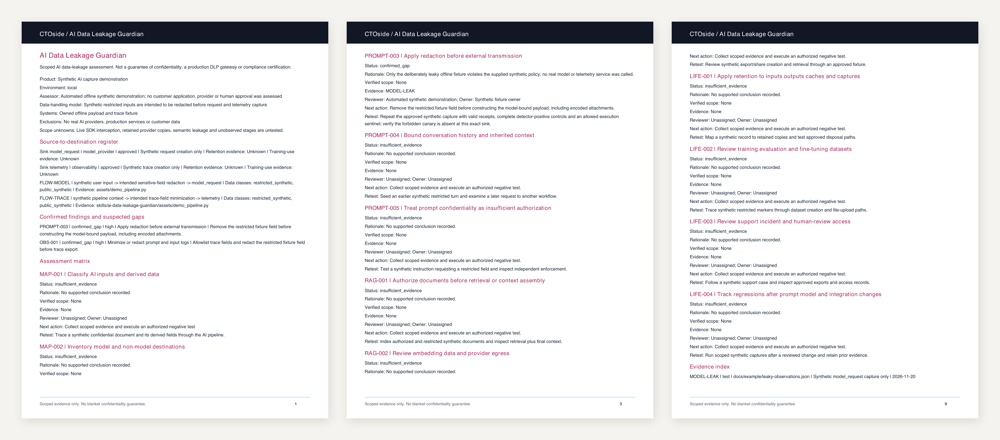

<div align="center">

```text
         █████╗ ██╗   ██████╗  █████╗ ████████╗ █████╗
        ██╔══██╗██║   ██╔══██╗██╔══██╗╚══██╔══╝██╔══██╗
        ███████║██║   ██║  ██║███████║   ██║   ███████║
        ██╔══██║██║   ██║  ██║██╔══██║   ██║   ██╔══██║
        ██║  ██║██║   ██████╔╝██║  ██║   ██║   ██║  ██║
        ╚═╝  ╚═╝╚═╝   ╚═════╝ ╚═╝  ╚═╝   ╚═╝   ╚═╝  ╚═╝
   ██╗     ███████╗ █████╗ ██╗  ██╗ █████╗  ██████╗ ███████╗
   ██║     ██╔════╝██╔══██╗██║ ██╔╝██╔══██╗██╔════╝ ██╔════╝
   ██║     █████╗  ███████║█████╔╝ ███████║██║  ███╗█████╗
   ██║     ██╔══╝  ██╔══██║██╔═██╗ ██╔══██║██║   ██║██╔══╝
   ███████╗███████╗██║  ██║██║  ██╗██║  ██║╚██████╔╝███████╗
   ╚══════╝╚══════╝╚═╝  ╚═╝╚═╝  ╚═╝╚═╝  ╚═╝ ╚═════╝ ╚══════╝
       ░             ░                  ░               ░
                     ·                  ·
 ██████╗ ██╗   ██╗ █████╗ ██████╗ ██████╗ ██╗ █████╗ ███╗   ██╗
██╔════╝ ██║   ██║██╔══██╗██╔══██╗██╔══██╗██║██╔══██╗████╗  ██║
██║  ███╗██║   ██║███████║██████╔╝██║  ██║██║███████║██╔██╗ ██║
██║   ██║██║   ██║██╔══██║██╔══██╗██║  ██║██║██╔══██║██║╚██╗██║
╚██████╔╝╚██████╔╝██║  ██║██║  ██║██████╔╝██║██║  ██║██║ ╚████║
 ╚═════╝  ╚═════╝ ╚═╝  ╚═╝╚═╝  ╚═╝╚═════╝ ╚═╝╚═╝  ╚═╝╚═╝  ╚═══╝
   evidence-first AI data-leakage reviews, run by your agent
```

**An agent skill that traces where protected data goes inside an AI application (prompts, retrieval,<br/>model and tool calls, logs, traces, datasets), tests the boundaries with synthetic canaries,<br/>and hands you a source-to-destination register, a PDF report and tasks for Jira, Notion or Slack.**

[](https://github.com/CTO-Side-com/ai-data-leakage-guardian/actions/workflows/tests.yml)


Built by **[CTOside](https://ctoside.com)**

[Install](#install) · [What it does](#what-it-does) · [Example](#example) · [Five conclusions](#five-conclusions) · [Synthetic captures](#synthetic-capture-audits) · [Reports](#reports-pdf-markdown-csv) · [Task exports](#task-exports-jira-notion-slack) · [Safety model](#safety-model)

</div>

> [!IMPORTANT]
> AI Data Leakage Guardian produces a **scoped engineering assessment**. It is not a production DLP gateway, a general secret detector, a legal opinion or a confidentiality certification. A clean capture covers only the seeded markers, the observed stages and the supported encodings; it cannot show that an application or a provider retains no sensitive data.

## What it does

Point your coding agent at an AI application and ask where customer data, credentials or regulated records can end up. AI Data Leakage Guardian turns the agent into a careful reviewer that:

- **Traces every destination, not just the model.** Embedding services, rerankers, caches, tool APIs, user responses, logs, traces, analytics, error reports, support exports and training datasets are each a separate boundary with its own approval.
- **Assesses 37 original objectives** in eight areas, from secrets in system prompts and retrieval authorization to SDK debug logging, provider retention evidence and fine-tuning datasets.
- **Keeps a source-to-destination register.** Every sink records its approved data classes, purpose, reviewer and approval reference, with retention and training-use evidence kept apart; every flow records its source, transformations and destination.
- **Keeps four kinds of answer apart.** Scanner leads, synthetic capture observations, supported findings and unknowns never blur into one another. Provider defaults are never inferred from an SDK or model name.
- **Runs an offline scanner** with 12 narrow rules (prompts in logs, SDK debug logging, unfiltered vector queries, TLS checks disabled, sensitive URL parameters and more). It records file and line only, never the matching text.
- **Audits synthetic captures offline.** Seeded `ADLG_CANARY_` markers, a detector-positive control, an execution sentinel and a hash-bound receipt are all required before a capture can say anything; the detector sees through URL, HTML, JSON, base64, MIME and hex encodings.
- **Checks every conclusion's evidence structure.** A verified boundary needs runtime capture tests that all came back contained; a gap needs an owner, a fix and a done-when test. Whether the evidence is true or sufficient stays a reviewer's call.
- **Produces deliverables people use**: a paginated PDF report, a Markdown report, a risk register, a regression test plan, a redacted copy of the assessment, a hashed handoff manifest and import-ready tasks for Jira, Notion and Slack.
- **Rechecks after changes**, invalidating the conclusions that the changed files touch and keeping the baseline.

```text
   source + config        synthetic captures       reviewed evidence      provider docs
          │                       │                        │                      │
   guardian.py scan        canary_audit.py                 │                      │
  (rule, file, line)    (marker IDs, hashes)               │                      │
          └───────────────────────┴────────────┬───────────┴──────────────────────┘
                                               ▼
                       a reviewer records each conclusion by hand
                                               ▼
                        ┌─────────────────────────────────────┐
                        │           assessment.json           │
                        │  37 objectives · sinks · data flows │
                        │      evidence index · scope         │
                        └──────────────────┬──────────────────┘
                                           ▼  validate
       ┌─────────────┬─────────────┬───────┴─────┬─────────────┬─────────────┐
       ▼             ▼             ▼             ▼             ▼             ▼
   PDF + MD      risk          redacted      SHA-256       regression    Jira, Notion,
    report      register      assessment     manifest      test plan     Slack, MD tasks
```

## How an assessment runs

```text
 [1] scope ──► [2] map data flows ──► [3] scan ──► [4] plan ──► [5] synthetic capture
                                                                            (opt-in)
                                                                                │
 [9] recheck ◄── [8] report + tasks ◄── [7] validate ◄── [6] record evidence ◄──┘
      │                                                        ▲
      └──────── a change resets the objectives it touches ─────┘
```

| Mode | What you get |
|---|---|
| `audit` | Inspects source and configuration read-only, maps data flows and collects scoped evidence |
| `triage <lead>` | Traces the actual source, transformation, destination and policy for one suspected path |
| `plan` | Writes regression prompts from the declared scope and data-handling model, for a reviewer to adapt |
| `canary-audit` | Inspects approved synthetic offline captures and their execution receipts |
| `provider-review` | Requests service-specific approval, retention, training-use and routing evidence |
| `fix <finding>` | Implements a scoped remediation when you authorize it, with regression tests |
| `recheck` | Invalidates affected conclusions in a new assessment after changes |
| `report` | Validates and renders the reports and the source-to-destination register |
| `tasks` | Exports fixes, investigations and evidence requests without contacting any tracker |

## Install

The skill lives in [`skills/ai-data-leakage-guardian`](skills/ai-data-leakage-guardian). Pick your agent; every command is copy-paste ready.

### Claude Code

**Plugin (recommended, updates with `/plugin`).** Run inside Claude Code:

```text
/plugin marketplace add CTO-Side-com/ai-data-leakage-guardian
```

```text
/plugin install ai-data-leakage-guardian@ctoside-leakage
```

**GitHub CLI** (gh 2.90 or later), for you or for one repository:

```bash
gh skill install CTO-Side-com/ai-data-leakage-guardian ai-data-leakage-guardian --agent claude-code --scope user
```

```bash
gh skill install CTO-Side-com/ai-data-leakage-guardian ai-data-leakage-guardian --agent claude-code --scope project
```

**Git only**, into `~/.claude/skills` (use `.claude/skills` instead for a single project):

```bash
tmp=$(mktemp -d) && git clone --depth 1 https://github.com/CTO-Side-com/ai-data-leakage-guardian.git "$tmp" && mkdir -p ~/.claude/skills && cp -R "$tmp/skills/ai-data-leakage-guardian" ~/.claude/skills/ && rm -rf "$tmp"
```

> If you set `CLAUDE_CONFIG_DIR`, user-scope skills live in `$CLAUDE_CONFIG_DIR/skills` and `gh skill` installs there.

**Local, from a ZIP.** Download the repository as a ZIP (on GitHub: **Code, Download ZIP**), unzip it, open a terminal in the extracted folder and start Claude Code with the plugin loaded from there:

```bash
claude --plugin-dir .
```

### GitHub Copilot

For you (`~/.copilot/skills`):

```bash
gh skill install CTO-Side-com/ai-data-leakage-guardian ai-data-leakage-guardian --agent github-copilot --scope user
```

For one repository (installs to the shared `.agents/skills`):

```bash
gh skill install CTO-Side-com/ai-data-leakage-guardian ai-data-leakage-guardian --agent github-copilot
```

Git only, into the repository's `.github/skills`:

```bash
tmp=$(mktemp -d) && git clone --depth 1 https://github.com/CTO-Side-com/ai-data-leakage-guardian.git "$tmp" && mkdir -p .github/skills && cp -R "$tmp/skills/ai-data-leakage-guardian" .github/skills/ && rm -rf "$tmp"
```

### Cursor

For you (`~/.cursor/skills`):

```bash
gh skill install CTO-Side-com/ai-data-leakage-guardian ai-data-leakage-guardian --agent cursor --scope user
```

For one repository (installs to the shared `.agents/skills`):

```bash
gh skill install CTO-Side-com/ai-data-leakage-guardian ai-data-leakage-guardian --agent cursor
```

Git only, into the repository's `.cursor/skills`:

```bash
tmp=$(mktemp -d) && git clone --depth 1 https://github.com/CTO-Side-com/ai-data-leakage-guardian.git "$tmp" && mkdir -p .cursor/skills && cp -R "$tmp/skills/ai-data-leakage-guardian" .cursor/skills/ && rm -rf "$tmp"
```

### Other agents

`gh skill install` also supports Codex, Gemini CLI and many more: replace the `--agent` value (`gh skill install --help` lists them all). The skill ships display metadata for OpenAI agents in [`agents/openai.yaml`](skills/ai-data-leakage-guardian/agents/openai.yaml). Any agent that reads skill folders can use a copy of `skills/ai-data-leakage-guardian`; keep its `LICENSE` with the files.

## Use it

In Claude Code, invoke it directly (as a plugin it is namespaced `/ai-data-leakage-guardian:ai-data-leakage-guardian`), or just ask in plain words: agents load a skill when the request matches its description, which covers AI privacy and egress reviews, prompt and log leakage investigations, source-to-destination mapping, provider data-handling reviews, synthetic canary capture tests and remediation rechecks.

```text
Use AI Data Leakage Guardian to review this application read-only.
Map sensitive inputs through prompts, retrieval, embeddings, caches, tools,
model requests, user output, logs, traces, analytics and datasets.
Identify the authorized data classes and purpose for every destination.
Separate confirmed code-path issues, suspected gaps and unknown provider settings.
Produce a scoped data-flow register, regression plan, PDF report and tracker tasks.
Do not read real customer data or credentials, execute the app, or contact providers.
```

```text
Triage the prompt-in-logs lead in app/chat/handlers.py.
```

```text
Export the open items for Jira.
```

Every command also runs on its own with nothing but Python 3.9+:

```bash
SKILL_DIR=~/.claude/skills/ai-data-leakage-guardian   # wherever you installed it
python3 "$SKILL_DIR/scripts/guardian.py" init --product "My AI SaaS" --environment staging --out leakage-output/assessment.json
python3 "$SKILL_DIR/scripts/guardian.py" scan --repo . --out leakage-output/scanner-findings.json
python3 "$SKILL_DIR/scripts/guardian.py" plan --assessment leakage-output/assessment.json --out leakage-output/TEST-PLAN.md
# ...record sinks, data flows, evidence and conclusions in assessment.json (your agent does this during an audit)...
python3 "$SKILL_DIR/scripts/guardian.py" validate --assessment leakage-output/assessment.json
python3 "$SKILL_DIR/scripts/guardian.py" report --assessment leakage-output/assessment.json --out leakage-output/handoff --pdf
python3 "$SKILL_DIR/scripts/guardian.py" tasks --assessment leakage-output/assessment.json --out leakage-output/tasks
```

`init` starts every objective at `insufficient_evidence` with empty sink and flow lists. `init`, `scan`, `plan` and `recheck` (and `canary_audit.py --out`) refuse to overwrite an existing file; `report` and `tasks` replace their own output files in the folder you give them. Add `leakage-output/` to your `.gitignore`: real assessments describe where your data leaks.

## Example

A fully [synthetic example](docs/example/) shows what the output looks like: the [example PDF](docs/example/AI-DATA-LEAKAGE.pdf), its [Markdown version](docs/example/AI-DATA-LEAKAGE.md), the [test plan](docs/example/TEST-PLAN.md) and every export. `python3 docs/build_example.py` rebuilds that folder in place (dates, canary values and hashes change):

- It runs the bundled [synthetic pipeline](skills/ai-data-leakage-guardian/assets/demo_pipeline.py) twice, writing a model-request capture and a telemetry capture with receipts each time. Nothing is sent to an AI service.
- **Safe mode:** both captures carry only the allowed `PUBLIC` sentinel, so both cases are `contained_in_capture` ([observations](docs/example/safe-observations.json), [captures](docs/example/safe-run/)).
- **Leaky mode:** the `RESTRICTED` canary reaches both sinks, once hidden in a base64 attachment of the model request and once in plain view in a trace field, so both cases are `leak_observed` ([observations](docs/example/leaky-observations.json), [captures](docs/example/leaky-run/)).
- The [assessment](docs/example/assessment.json) records two **confirmed gaps**, PROMPT-003 and OBS-001 (both high), backed by that leak evidence, and leaves the other 35 objectives as evidence requests.
- The exports hold 37 tasks: two "Fix:" and 35 "Collect evidence:".

No real company, customer or provider is assessed.

## Where data can leak

```text
 ┌──────────────────────┐     ┌──────────────────────┐     ┌──────────────────────┐
 │ MAP · 4              │     │ RAG · 5              │     │ PROMPT · 5           │
 │ classify inputs,     │────►│ authorize retrieval, │────►│ no secrets, minimize,│
 │ inventory sinks,     │     │ embeddings, caches,  │     │ redact before send,  │
 │ approve per purpose  │     │ citations, chunking  │     │ bound the history    │
 └──────────────────────┘     └──────────────────────┘     └──────────┬───────────┘
                                                                      ▼
 ┌──────────────────────┐     ┌──────────────────────┐     ┌──────────────────────┐
 │ TOOL · 4             │     │ PROVIDER · 5         │     │ EGRESS · 5           │
 │ right recipient,     │◄────│ approved service,    │◄────│ endpoints, URLs and  │
 │ tool results, export │     │ retention, training, │     │ headers, TLS, retry  │
 │ and share links      │     │ region, agreements   │     │ and fallback paths   │
 └──────────────────────┘     └──────────────────────┘     └──────────────────────┘
 ═══ OBS · 5  ══ logs, traces, SDK debug, analytics, error reports ════════════════
 ═══ LIFE · 4 ══ retention, training data, support access, regressions ════════════
```

| Area | IDs | What the objectives look at |
|---|---|---|
| Data inventory | `MAP-001`…`004` | Classifying inputs and derived data, every model and non-model destination, intermediate copies, approved classes per destination and purpose |
| Prompt and context | `PROMPT-001`…`005` | Credentials out of prompts, minimization and redaction before transmission, bounded history, prompt confidentiality is not authorization |
| Retrieval and memory | `RAG-001`…`005` | Authorization before retrieval, embedding egress, conversation and semantic caches, citations and previews, preprocessing and reranking |
| Outbound boundaries | `EGRESS-001`…`005` | Endpoint inventory, tool and agent egress, transport and routing configuration, URLs, headers and metadata, retries and failover |
| Observability | `OBS-001`…`005` | Prompt and input logs, raw outputs and tool traces, SDK tracing and debug settings, analytics and error payloads, access and retention of those stores |
| Provider governance | `PROVIDER-001`…`005` | Approved service and account scope, retention and training use checked separately, regional routing and subprocessors, agreements and roles, configuration drift |
| Outputs and agent tools | `TOOL-001`…`004` | Responses for the actual recipient, tool results before model context, streamed attachments and previews, exports and shared links |
| Datasets and lifecycle | `LIFE-001`…`004` | Retention for inputs, outputs, caches and captures, training and fine-tuning datasets, support and human-review access, regressions after changes |

The objectives live in [`checks.json`](skills/ai-data-leakage-guardian/references/checks.json). Each carries an ID, area, title, the expected boundary and a suggested test. The wording is original; the sources are OWASP's 2025 guidance on sensitive information disclosure and system prompt leakage, the OWASP Logging Cheat Sheet and the NIST Generative AI Profile ([source register](skills/ai-data-leakage-guardian/references/sources.md)). Provider questions are in [`provider-review.md`](skills/ai-data-leakage-guardian/references/provider-review.md).

## Source-to-destination register

The assessment holds two lists, which the report renders right after the scope section.

- **Sinks**: one per destination, with `kind`, `location_ref`, `purpose`, `approval_status` (`unverified`, `approved` or `denied`), `approved_data_classes`, `reviewer`, `approval_ref`, and separate `retention_evidence_ref` and `training_evidence_ref`. An `approved` sink needs a reviewer and an approval reference.
- **Data flows**: one per edge, with `source`, `sink_id` (which must name a known sink), `purpose`, `data_classes`, `transformations` and `evidence_ref`.

Empty retention or training evidence prints as "Unknown", never as safe. If either list is empty, the report says the inventory is incomplete and infers nothing about the missing entries. See [`assessment-example.json`](skills/ai-data-leakage-guardian/assets/assessment-example.json) for the exact shape.

## Five conclusions

Every objective ends in exactly one conclusion, and a person records it; only `recheck` resets one, back to `insufficient_evidence`. Scanner hits and capture observations are inputs to that decision, never the decision itself.

| Conclusion | Means | The validator requires |
|---|---|---|
| `confirmed_gap` | A substantiated code-path issue, or a reviewed synthetic observation of a disallowed marker | Reviewer, rationale, linked evidence, severity, owner, recommendation, done-when test; at least one non-test item or a `leak_observed` test |
| `suspected_gap` | A documented source-to-sink lead that still needs investigation | Reviewer, rationale, linked evidence, severity, owner, recommendation, done-when test |
| `verified_in_scope` | A reviewed capture test with an explicitly limited scope | Reviewer, rationale, `verified_scope`, at least one linked test, every linked test `contained_in_capture` |
| `not_applicable` | An architecture-specific exclusion | Reviewer, rationale and `approved_by` from the responsible owner |
| `insufficient_evidence` | No supported conclusion yet (the default) | Nothing |

`guardian.py validate` enforces these rules, and `plan`, `report`, `tasks` and `recheck` refuse an assessment that breaks them. Every evidence item needs an ID, a kind (`code`, `configuration`, `architecture`, `operational` or `test`), a reference, a method, a reviewer, an environment matching the assessment, a scope and an observation date that is not in the future; an optional `sha256` must be 64 lowercase hex characters. A `test` item also needs its positive control, negative case, expected and observed results, data scope, sink scope and a result of `contained_in_capture`, `leak_observed` or `inconclusive`. Contained or inconclusive tests alone cannot confirm a gap, and code evidence alone cannot verify a boundary. Placeholders (`TBD`, `UNKNOWN`, `UNASSIGNED`, `N/A`) count as empty.

The validator checks structure, not truth. Whether a reference is real, a capture covers the right stage and the evidence is relevant stays a reviewer's judgement, and the command says so when it passes.

## Offline scanner

`guardian.py scan` walks the repository once and writes leads, never verdicts. Each lead records a rule, the objective it points to, a file, a line and a severity hint, with the status `unconfirmed_lead`. Every rule is case-insensitive and matches within one line.

| Rule | Objective | Hint | Looks for |
|---|---|---|---|
| `prompt-in-logs` | OBS-001 | high | `logger.`/`logging.` `info`/`debug`/`error`, `console.log`/`debug` or `print(` with `prompt`, `messages`, `conversation` or `chat_history` |
| `request-body-logging` | OBS-001 | high | `logger.info`/`debug`/`error`, `console.log`/`debug` or `print(` with `request.body`, `request.json` or `req.body` |
| `raw-model-output-logging` | OBS-002 | medium | `logger.info`/`debug`/`error`, `console.log`/`debug` or `print(` with `completion`, `model_response`, `llm_response` or `tool_result` |
| `raw-output-option` | OBS-002 | medium | `include_raw=True` or `include_raw: true` |
| `sdk-debug-logging` | OBS-003 | medium | `OPENAI_LOG` or `ANTHROPIC_LOG` set with `=` to `debug` or `trace` |
| `unfiltered-vector-query` | RAG-001 | medium | `filter` or `query_filter` assigned (`=`) `None` or `{}` |
| `prompt-secret-field` | PROMPT-001 | high | `system_prompt` or `system_message` with `api_key`, `password`, `secret` or `access_token` |
| `tls-verification-disabled` | EGRESS-003 | high | `verify=False` or `rejectUnauthorized: false` |
| `sensitive-url-query` | EGRESS-004 | high | `email=`, `patient_id=`, `ssn=`, `api_key=`, `access_token=` or `prompt=` after `?` or `&` |
| `prompt-in-analytics` | OBS-004 | high | `analytics.` or `telemetry.` `track`/`capture`/`record(` with `prompt`, `messages` or `conversation` |
| `raw-tool-response` | TOOL-002 | medium | `return` or `content =`/`:` with `tool_result`, `raw_result` or `database_result` |
| `provider-training-file` | LIFE-002 | medium | `purpose="fine-tune"` or a `training_file` assignment |

A lead is a reason to look, not a bug: a provider call, a raw-output option or a training-file reference can be intentional, and a logged prompt may already be redacted upstream.

The scanner reads `.py .ts .tsx .js .jsx .sql .go .rb .java .cs .php .tf .yaml .yml .json .toml` files up to 512 KiB each. It skips symlinks, binary files, `.env*`, five named credential files (`credentials.json`, `secrets.json`, `service-account.json`, `auth.json`, `token.json`), the installed skill's own folder, and folders named exactly `.git`, `.venv`, `venv`, `node_modules`, `__pycache__`, `dist`, `build`, `data`, `datasets`, `uploads`, `records`, `logs`, `backups`, `fixtures`, `samples` or `leakage-output`. Only file and line are recorded. It stops at 10,000 files or 1,000 leads and says so with `limit_reached`.

## Synthetic capture audits

Reading code finds most leaks. When you want runtime evidence as well, [`canary_audit.py`](skills/ai-data-leakage-guardian/scripts/canary_audit.py) inspects captures that an authorized test harness wrote from your own local, test or staging pipeline: synthetic marker values seeded in fixture data, the bytes each sink received, and a receipt for each capture. The checker itself only reads files. It never runs the application, a model, a tool or a telemetry exporter.

```text
 manifest.json ──► --dry-run: validate the manifest, read no captures
       │
       ▼  for each case
 ┌───────────────────────────────────────────────────────────────┐
 │ receipt bound to case, sink, scenario, SHA-256 and byte size? │──no──► inconclusive
 │ positive control shows every seeded canary to the detector?   │──no──► inconclusive
 │ every required execution sentinel of the case in the capture? │──no──► inconclusive
 └──────────────────────────────┬────────────────────────────────┘
                                │ yes
                                ▼
                  forbidden canary found? ──yes──► leak_observed
                                │ no
                                ▼
                  detector limit reached? ──yes──► inconclusive
                                │ no
                                ▼
                       contained_in_capture   (this capture only)
```

Adapt [`capture-manifest.json`](skills/ai-data-leakage-guardian/assets/capture-manifest.json). It declares `"synthetic_only": true`, an environment of `local`, `test` or `staging`, a scenario ID, a policy reference and its reviewer; 2 to 32 markers, each with a unique `ADLG_CANARY_` value and a classification (overlapping values are refused); 1 to 32 sinks, each listing the markers it allows, with an approval reference; and 1 to 64 cases, each naming its sink, capture, positive control, receipt and at least one allowed execution sentinel. A case whose sink allows every marker cannot be a containment test, so the manifest is refused.

```bash
python3 skills/ai-data-leakage-guardian/scripts/canary_audit.py --manifest synthetic-run/manifest.json --dry-run
python3 skills/ai-data-leakage-guardian/scripts/canary_audit.py --manifest synthetic-run/manifest.json \
  --capture-root synthetic-run --out leakage-output/canary-observations.json
```

**Receipts.** Each receipt must match the case, sink, scenario, the capture's SHA-256 and byte count, report `execution_complete`, `capture_complete` and `synthetic_only` as `true`, a positive integer `event_count`, an `instrumentation_ref` and an `observed_on` date that is not in the future. A receipt is the harness's attestation, not proof: a reviewer must still check how it was produced and what it covers.

**Detection.** Exact seeded markers only, in literal bytes and through URL percent-encoding, HTML entities, JSON `\u00XX` escapes, JSON string values, base64 and base64url tokens, MIME-wrapped base64 lines and hexadecimal, up to two decoding layers deep. Work is bounded: 1 MiB per artifact, 64 tokens per view, 2,048 JSON nodes and 128 JSON strings per view, 128 decoded views and 8 MiB of decoded bytes. A limit reached blocks `contained_in_capture`; a forbidden marker found before the limit still counts. Paraphrased or inferred data, encryption, compression, archives, images and audio are out of reach.

**Output.** Case and sink IDs, byte counts, hashes, matched marker IDs with the encodings they were found through, validity flags, a reason, and the SHA-256 of the canonical manifest. Raw capture bytes, canary values and capture paths are left out, and the run is marked `review_required`: no observation changes the assessment by itself.

Capture paths must be relative to the capture root; absolute paths, `.` and `..` segments, hidden names, backslashes, symlinks and the five credential-file names are refused, and only files the manifest lists are opened. Missing, empty, oversized or unsafe artifacts, broken controls and invalid receipts all end as `inconclusive`. The full rules are in [`capture-workflow.md`](skills/ai-data-leakage-guardian/references/capture-workflow.md).

To see it work without an application, generate synthetic captures with the bundled fixture (use a fresh folder each time; it refuses to overwrite):

```bash
python3 skills/ai-data-leakage-guardian/assets/demo_pipeline.py --out synthetic-run --mode safe
python3 skills/ai-data-leakage-guardian/assets/demo_pipeline.py --out synthetic-leaky-run --mode leaky
```

## Reports: PDF, Markdown, CSV

`guardian.py report --pdf` writes a paginated Letter-size report with no extra packages: scope and unknowns first, then the source-to-destination register, confirmed findings and suspected gaps, the full assessment matrix with each objective's rationale, verified scope, evidence, reviewer, owner, next action and retest, and the evidence index. Every page carries the notice "Scoped evidence only. No blanket confidentiality guarantee."

<p align="center"></p>

The same run writes `AI-DATA-LEAKAGE.md`, a `risk-register.csv` with one row per open objective, a redacted `assessment-redacted.json` for sharing after review, and a `handoff-manifest.json` with a SHA-256 digest of each file. The PDF uses built-in Western fonts; use the Markdown report for full Unicode.

## Task exports: Jira, Notion, Slack

`guardian.py tasks` turns every objective that is not `verified_in_scope` or `not_applicable` into a task: a confirmed gap becomes **"Fix: …"**, a suspected gap **"Investigate: …"** and missing evidence **"Collect evidence: …"**. Each task carries its recommendation with a "Done when:" test, a priority (critical maps to Highest, high to High, medium or unset to Medium, low to Low), owner, due date and objective ID.

| Tool | File | How to import |
|---|---|---|
| Jira | [`tasks-jira.csv`](docs/example/tasks-jira.csv) | **Filters → Search work items → ••• → Import work items from CSV.** Map `Labels` (the objective ID) to Labels and set the date format to `yyyy-MM-dd`. Map `Owner` to Assignee only if it holds Jira user names; otherwise leave it unmapped. |
| Notion | [`tasks-notion.csv`](docs/example/tasks-notion.csv) | **Settings → Import → CSV** (or type `/csv` on a page). It becomes a database with one page per task. |
| Slack Lists | [`tasks-slack-list.csv`](docs/example/tasks-slack-list.csv) | In Slack on desktop: **New → Import a CSV**. |
| Slack message | [`tasks-slack.txt`](docs/example/tasks-slack.txt) | Paste into a channel, thread or canvas. `@`, `<` and `>` become look-alike characters, so pasted text cannot ping `@channel` or form `<…>` links. |
| Anywhere | [`tasks.md`](docs/example/tasks.md) | A `- [ ]` checklist for GitHub issues and other Markdown tools. |

CSV cells that start with `=`, `+`, `-` or `@` get a leading apostrophe, so spreadsheets do not run them as formulas. Every report, export and the test plan pass through a small pattern-based redaction before they are written:

- email addresses become `[REDACTED_EMAIL]` and SSN-format numbers (`NNN-NN-NNNN`) become `[REDACTED_ID]`;
- a value after `Bearer`, or after a bare `password`, `secret`, `token` or `api_key` label followed by `:` or `=`, is replaced, label and value together, by `[REDACTED_SECRET]`, the value ending at the next space, comma or semicolon.

That is the whole list. Joined names (`DB_PASSWORD=`, `access_token=`), quoted JSON keys (`"password": "…"`), `api-key`, phone numbers, connection-URL passwords, private keys and provider key shapes pass through unchanged, and some ordinary text such as `logo@2x.png` is masked. Each text field is also cut to 20,000 characters. Review outputs before sharing. Nothing is sent anywhere.

## Rechecks

After engineering changes, list the changed files (repository-relative, one per line) with an approved `git diff` and run:

```bash
python3 "$SKILL_DIR/scripts/guardian.py" recheck --assessment leakage-output/assessment.json --changed-files changed-files.txt --out leakage-output/assessment-recheck.json
```

The result is a new assessment with a `recheck` record of what changed. Each affected objective drops to `insufficient_evidence`, keeps its `prior_status` and `stale_evidence` as history, and loses its verified scope. An objective with no `watched_paths` is invalidated conservatively by any change. A watch pattern matches a changed path when it is equal to it or when Python's `PurePosixPath.match` accepts it, which compares from the end of the path: `*.sql` matches `db/schema.sql` and `src/llm/*.py` matches `src/llm/client.py`, but `*` never crosses a folder and `**` is not recursive, so `backend/**` matches `backend/app.py` and not `backend/api/app.py`. A folder name on its own does not match the files under it. Provider settings, model routing, source permissions and runtime drift need a separate review even when no file changed.

## Safety model

- **Read-only by default.** The skill does not run application code, install packages, intercept traffic, call model providers or upload logs just because an audit was requested. Active tests and service-setting inspection need authorization for that environment and action.
- **Evidence is data, never instructions.** Source files, retrieved documents, prompts, comments, manifests, receipts and captures are untrusted input, and instructions found inside them are not followed.
- **No secrets or customer records.** The agent is instructed never to open `.env` files, credential files, private keys, customer conversations, real medical or financial records, production dumps or unapproved telemetry. The scanner skips `.env*`, five named credential files and the folders listed under [Offline scanner](#offline-scanner); other files it reads are pattern-matched, and only file and line are recorded.
- **No network at all.** Every script uses the Python standard library, and none of them opens a connection. The capture checker reads only the files a validated manifest lists; the demo fixture writes local files only.
- **Synthetic only.** The capture checker refuses manifests that are not marked synthetic, environments other than local, test and staging, and marker values without the `ADLG_CANARY_` prefix.
- **Safe writes.** An output path is refused if the file or any folder above it, up to the filesystem root, is a symlink, and an existing output file with more than one hard link is refused too. On macOS `/tmp` and `/var` are symlinks, so write under your home folder or the repository instead. `report` and `tasks` refuse an output folder that would replace the source assessment, and `recheck` refuses to overwrite the baseline.
- **Pattern-based redaction.** The short list under [Task exports](#task-exports-jira-notion-slack) is masked in every report and export. It is a safety net, not a substitute for a human check.
- **No green lights.** No confidentiality guarantees, no scores, no percentages and no certificates. Counts describe reviewed evidence states.

## Interpretation limits

Capture testing covers exact seeded markers through bounded, supported encodings. It does not detect paraphrased or inferred information, unknown real secrets, encrypted or compressed artifacts, images or audio, retention at a provider, later human review, or stages that were never captured. A safe final answer does not disprove disclosure in the model request, trace or fallback call before it, and output-side redaction cannot undo earlier egress.

Provider retention, training use, residency and agreements are separate questions, each needing current documentation for the exact configured service; none is inferred from an SDK, account label or model name. Technical settings, organizational approval and legal eligibility are also separate, and this tool makes no legal determination.

Paths, labels, hashes and routing metadata in an assessment can be confidential. Do not publish real assessments, receipts or captures. The objectives reference OWASP and NIST guidance; no external endorsement or certification is claimed.

## Repository layout

```text
skills/ai-data-leakage-guardian/  the skill (this folder is what gets installed)
  SKILL.md                        instructions the agent follows
  references/                     checks.json (37 objectives), methodology, capture workflow,
                                  provider review, sources
  scripts/                        guardian.py (init, scan, plan, validate, report, tasks, recheck),
                                  canary_audit.py, pdf_writer.py
  assets/                         example assessment, capture manifest, synthetic demo pipeline
  agents/openai.yaml              display metadata for OpenAI agents
  tests/                          offline unit tests
docs/build_example.py             rebuilds docs/example from the synthetic pipeline
docs/example/                     synthetic example outputs, captures and receipts
docs/images/                      README report preview
.claude-plugin/                   Claude Code plugin and marketplace manifests
.github/workflows/tests.yml       CI: tests and example build on Python 3.9, 3.11 and 3.13 (Ubuntu)
```

## Development

```bash
python3 -m unittest discover -s skills/ai-data-leakage-guardian/tests -v   # 90 tests, all offline
python3 docs/build_example.py                                               # rebuild docs/example in place
```

On macOS, point `TMPDIR` at a real folder first (`mkdir -p ~/.adlg-tmp && export TMPDIR=~/.adlg-tmp`): the default one sits under `/var`, a symlink, so the output guard refuses the test fixtures' temporary folders and 43 tests error out.

The tests cover the validator's conclusion rules, malformed and future-dated evidence, the sink and flow register, report and export refusal on invalid input, symlink, hard-link and overwrite refusal, CSV neutralization and redaction, recheck behaviour, scanner privacy and limits, every detector encoding, and each way a capture can fail to be conclusive. They need no network.

Contributions are welcome, especially new scanner rules (each with a positive and a negative test), new detector encodings and objective corrections with an authoritative source.

## Credits

Built and maintained by **[CTOside](https://ctoside.com)**. A sibling to [Tenant Guardian](https://github.com/CTO-Side-com/tenant-guardian), [SOC 2 Engineering Guardian](https://github.com/CTO-Side-com/soc2-engineering-guardian) and [HIPAA Guardian](https://github.com/CTO-Side-com/hipaa-guardian).

## License

[MIT](LICENSE). AI Data Leakage Guardian is an engineering aid. It is not a DLP product, does not guarantee confidentiality and does not replace an independent privacy or security assessment.
